# Archboard AI integration plan

> Retired from the application runtime on October 14, 2026. Retained as a legacy
> implementation reference. See [Project JSON](docs/project-context.md) for the current
> local import workflow; legacy enablement does not activate hosted AI.

Research date: **3 October 2026**. Status: **proposal for implementation**.

This extends [plan.md](./plan.md) with AI diagram generation and architecture
guidance. The user has selected **GitHub as the only login** and **AI provided
entirely through Archboard's own server-managed provider account**.

The initial integration uses **OpenAI only**, through its API and the official
`openai` Node.js/TypeScript SDK in the NestJS backend. The application-owned provider
interface remains independent so a Claude adapter can be added later as separate
work. No second provider, credential, or SDK is required for this version.

The first version accepts a specific prompt, a guided project description, or
project-context JSON. Support for projects on the user's computer begins with
descriptions and JSON files; a helper that prepares those descriptions comes later.

This is a planning document. No application implementation, deployment, paid AI
request, or transmission of project files is part of this documentation change.

## 1. Product direction and ownership

Build an assistant that creates **editable Archboard diagrams** and helps users
understand, explain, and improve them.

Archboard controls the integration:

- GitHub identity and existing application sessions determine who can use AI.
- The operator supplies the provider account and server-side API credentials.
- Server configuration determines the OpenAI model and generation limits.
- Archboard sets per-account quotas, global spending budgets, and concurrency limits.
- Users describe what they want, review proposals, and choose what to apply.
- AI credential setup and billing management belong to the operator.

There is no end-user AI connection flow or payer selection. Generation always uses
Archboard's configured AI service. Provider errors stop the run; they do not switch
credentials or funding sources automatically.

A hosted model provider still performs inference on the context sent to it.
“Controlled by Archboard” means control of integration, credentials, access,
workflow, and spending. It does not mean the model runs on Archboard's hardware.

Recommended delivery order: **prompt/form/JSON generation → architecture guidance →
scoped edits and presentation proposals → optional project-description helper**.

Example: upload a description of a private project and ask, “Draw the login request
flow. Show the browser, API, session handling, and database. Do not invent services.”
Archboard asks about essential missing information, generates a preview, and lets
the user review and apply it.

## 2. First version: prompt and project-context JSON

### 2.1 Input paths

**Prompt only:** the user describes their architecture and the desired diagram.
The assistant asks relevant questions when necessary or labels optional assumptions.

**Guided form:** collect project name, purpose, technologies, components,
connections, constraints, and diagram focus. Export a project-context JSON file
so users can reuse or edit the description without writing JSON manually.

**Upload JSON:** accept one UTF-8 project-description file, validate it locally,
show a readable summary and the content to be sent, and combine it with the prompt.
Selecting the file does not start a provider request; Generate is a separate action.

**Current board or selection:** include only the board context the user chooses
for follow-up guidance or a scoped edit. Never silently include unrelated board
content, comments, memberships, or private conversation history.

The first version does not need folder scanning, archives, or arbitrary source-file
uploads. A project can remain on the user's computer and private. Its description
is sufficient input, and publishing it on GitHub is unnecessary.

A description-based diagram reflects the supplied information. It cannot
independently confirm what the project's code actually does.

### 2.2 Project descriptions and diagram exports are different

| File                             | Purpose                                                          | Processing                                                                          |
| -------------------------------- | ---------------------------------------------------------------- | ----------------------------------------------------------------------------------- |
| `project.archboard-context.json` | Describe a system and optionally provide supporting evidence     | Validate, generate a proposal, preview, apply                                       |
| Existing Archboard board JSON    | Portable diagram with graph objects, coordinates, and references | Existing validated import/export flow; optionally include it as explicit AI context |

Do not change the existing board import format or treat a project-context file as
an exported board. A context file uses logical component keys rather than persistent
graph UUIDs. It cannot contain roles, sessions, credentials, or raw Yjs bytes.

The prompt selects a useful view: system overview, login flow, deployment
description, or another projection supported by existing card and edge types.

### 2.3 Proposed context format

Define a strict, versioned schema in shared contracts. This example is a proposed
input format, not an implemented feature.

```json
{
  "kind": "archboard.project-context",
  "schemaVersion": 1,
  "project": {
    "name": "My private project",
    "description": "A task tracker with background notifications.",
    "technologies": ["React", "NestJS", "PostgreSQL"]
  },
  "components": [
    {
      "key": "web",
      "name": "Web app",
      "category": "client",
      "technology": "React",
      "description": "Users view and update tasks."
    },
    {
      "key": "api",
      "name": "Task API",
      "category": "service",
      "technology": "NestJS",
      "description": "Checks permissions and processes task requests."
    },
    {
      "key": "db",
      "name": "Task database",
      "category": "database",
      "technology": "PostgreSQL",
      "description": "Stores tasks and memberships."
    }
  ],
  "connections": [
    {
      "source": "web",
      "target": "api",
      "label": "Create or update task",
      "protocol": "HTTPS"
    },
    {
      "source": "api",
      "target": "db",
      "label": "Read and write tasks",
      "protocol": "SQL"
    }
  ],
  "constraints": ["Only editors can change tasks."],
  "unknowns": ["Notification worker details have not been documented."]
}
```

Require `kind`, `schemaVersion`, and `project`. Omitted collection fields
normalize to empty arrays, and the guided form exports the complete normalized
format. Component keys must be unique; connections must resolve to supplied
components. Reuse existing component categories and applicable text limits.

Reject unsupported versions, unknown properties, duplicate keys, malformed
collections, and broken references with actionable field errors. Do not infer a
different input format from arbitrary JSON.

Optional schema fields can include visual boundaries with logical component
references and evidence entries with unique keys, project-relative paths, positive
line ranges, bounded excerpts, and optional file hashes. Define these fields
strictly before accepting them; do not add an arbitrary metadata bag.

Evidence paths are labels, not permission to read a file or fetch a URL. Validate
relative paths and omit absolute computer paths from provider context. Uploaded
evidence is user-supplied; a hash alone does not establish that Archboard inspected
the actual code. The first useful release can accept descriptions without evidence.

### 2.4 Useful prompts and accuracy

Offer prompt starters:

- “Draw only the components described in this file. Flag missing connections.”
- “Explain the login flow and show its trust boundaries.”
- “Help me prepare a three-minute recruiter walkthrough.”
- “Suggest improvements and explain their tradeoffs before changing the diagram.”

Use three provenance labels: **provided in description**, **supported by supplied
source evidence**, and **assumption/suggestion**. Keep explanations and evidence
outside the graph schema. Avoid model-generated confidence percentages that
appear to be measured accuracy.

Ask up to three focused questions when missing facts materially change the result.
For example, the sample mentions notifications without describing a worker: ask
whether to omit that flow or include a clearly marked proposed design.

Provide distinct actions for **diagram the described system** and **propose a
design**. Suggestions must not appear to be facts about the existing project.
Do not invent caches, queues, microservices, or deployment infrastructure.

## 3. AI provider integration

### 3.1 Server-owned provider

Build provider-independent infrastructure with one production adapter initially:
OpenAI Responses, using Archboard's operator-owned OpenAI API account and server-only
credentials. Add the official `openai` package to the API application when implementing
the adapter; do not install a second provider SDK for this version.
[Official OpenAI SDK documentation](https://developers.openai.com/api/docs/libraries)

The SDK is an installable package that makes HTTPS requests to OpenAI's API. The
browser calls Archboard's own API; the backend checks access, cache, rate limits,
and budget before invoking the SDK. It validates generated diagram JSON before
returning a reviewable proposal. API credentials and provider URLs stay server-side.

Claude support is deferred. Adding it later requires implementing and testing its
adapter and operator configuration; it is not available by changing configuration
today. Once that adapter exists, switching providers should not require changes
to product flows, graph schemas, or the run service.

Normalize instructions, messages, structured output, streaming, usage, errors,
deadlines, and cancellation at an application-owned provider interface. Provider SDK
types and caching parameters stay inside adapters. No automatic cross-provider
failover is enabled: a switch is an operator decision and invalidates result-cache
entries for the previous provider/model/configuration.

Users do not select a credential source or configure the underlying provider.
Expose product choices such as diagram focus and optional quality level only when
the operator has explicitly mapped them to supported models and bounded costs.

Never expose an anonymous unlimited inference proxy. The hosted AI endpoints require
a GitHub-authenticated Archboard session and the applicable board permissions.

Choose exact model IDs through server configuration. Evaluate candidate models on
Archboard fixtures for grounding, validity, latency, and cost. Do not hardcode a
“latest” model, provider-specific schema, or pricing assumption into saved diagrams.

### 3.2 Responses and structured output

For the OpenAI adapter, use Responses structured output with `text.format`,
`type: "json_schema"`, and `strict: true` where the configured model supports it.
Validate every result again
with shared Zod contracts and domain rules. Matching JSON Schema does not prove
that the architecture is factually correct.
[Official structured-output guide](https://developers.openai.com/api/docs/guides/structured-outputs)

The OpenAI adapter uses `store: false` and bounded `max_output_tokens`. Keep these
provider-specific fields inside the adapter. Stream status and explanation
where useful, but only a completed, validated result can become an applicable
proposal. Handle refusals, incomplete results, provider failures, and disconnected
streams separately. Keep bounded conversation context in the application rather
than relying on a provider-hosted conversation.
[Responses API reference](https://developers.openai.com/api/reference/cli/resources/responses/methods/create)

Begin with text input and output. Read and validate uploaded context in Archboard,
then send the reviewed description as text. Diagram generation requires neither
provider file search nor an image-generation service.

If schema compatibility fails, report it or use a tested, bounded text-to-JSON
fallback. Permit at most one repair request within the original cost budget.
Never apply malformed or partial output.

### 3.3 Credentials, quotas, and spending

Only the backend can read the provider key. Keep it out of `VITE_*`, public
bundles, browser storage, graph documents, exports, logs, and support output.
Use a dedicated production secret, separate development configuration, and a
documented operator rotation process.

Before submitting a paid request:

1. Authenticate the actor and verify access to all included context.
2. Validate request size, token budget, model selection, and task type.
3. Enforce per-account and global concurrency limits.
4. Atomically reserve a conservative maximum estimated cost.
5. Associate the request with a durable user-owned run and idempotency record.

Set a hard output-token limit and use the configured model pricing table to
estimate the reservation. Reconcile actual usage afterward. When actual usage
cannot be recovered, conservatively account for the unknown outcome rather than
releasing the budget and blindly retrying.

Provider execution cannot be assumed exactly once across a process crash. A run
with uncertain execution returns `outcome-unknown`; client retries and SSE
reconnections must not start another provider call. Aborting a stream does not
prove that no provider usage occurred.

The operator controls a configurable daily/monthly spending ceiling, per-account
request allowance, and an emergency AI disable switch. Product messages can explain
“AI allowance reached” without exposing the provider key, account, or billing details.
Exact money amounts and model prices are implementation-time operator decisions.

### 3.4 Caching without weakening access controls

Use two distinct mechanisms: application result caching avoids a provider call;
provider prompt caching reduces repeated input processing while still generating
an output. Neither replaces rate limits, budget admission, or idempotency.

Cache only completed, validated semantic proposals, scoped to deployment, actor,
board/new-board namespace, exact normalized context and conversation, task,
provider/model, policy, prompt/schema, and adapter versions. Recheck current board
authority before a lookup or return. Use keyed hashes, a short fixed TTL, byte/entry
bounds, and explicit expiry. Do not share private results between users, reuse
approximate matches, or cache errors, partial streams, credentials, generated UUIDs,
or application receipts. Repeated identical in-flight runs should share one existing
run within that same authorization scope.

Provider prompt-cache settings are adapter-specific optimizations. Put stable
instructions/schema ahead of changing user context, verify current model support,
and account for cache-write charges as well as cache reads. Cache hits must not be
assumed during cost reservation, and provider caching is not free output generation.
[OpenAI prompt caching](https://developers.openai.com/api/docs/guides/prompt-caching)

Protected AI HTTP responses remain `Cache-Control: no-store`; internal result
caching does not permit public CDN, service-worker, or browser HTTP caching.

### 3.5 Durable admission and bounded execution

Use bounded cheap HTTP admission plus authenticated request, fresh-inference,
token, concurrency, and monetary limits. Cached and idempotent requests still
consume cheap request limits but do not create another paid attempt. Enforce global
and per-account spending atomically in the existing PostgreSQL infrastructure,
including restart-safe reservations and outstanding unknown outcomes across budget
period changes. No additional Redis service is required for this initial scope.

Persist intent/admission in short transactions, call the provider outside a
database transaction, then settle results/usage in another short transaction. SDK
retries must be disabled or explicitly controlled. Retry only definite rejections
under the same deadline and reservation; never retry ambiguous transmission or
started generation automatically. Fail closed if authoritative cost coordination
is unavailable. The commit guide specifies implementation and deferred proof.

## 4. Editable diagram generation

### 4.1 Pipeline

```mermaid
flowchart LR
  A[Prompt / form / project JSON] --> B[Validate and review context]
  B --> C[Authenticated Archboard AI API]
  C --> D[Generate semantic proposal]
  D --> E[Validate proposal and references]
  E --> F[Compute layout]
  F --> G[Preview and user review]
  G --> H[Apply document commands]
  H --> I[Yjs / local persistence / normal sync]
```



Request a bounded semantic proposal: logical components, typed content,
connections, optional visual groups, explanation, assumptions, and questions.
Application code generates UUIDs, coordinates, sizes, handles, and ownership.

Never ask the model to produce raw Yjs updates, React Flow internals, executable
code, or arbitrary HTML/SVG. Existing SVG/PNG export renders the final editable
board.

Compute layout in application code. Evaluate `elkjs` in a worker for directed
diagrams; it computes positions and supports worker execution.
[Official elkjs repository](https://github.com/kieler/elkjs)
Pin a compatible version after reviewing Vite integration and licensing. Map
geometry to Archboard's four fixed handles. Visual boundaries remain absolute
rectangles rather than nested React Flow parents.

Use stable input ordering and test bounded positions, overlap, disconnected
components, and labels on fixtures. Layout output is validated before rendering
or persistence.

### 4.2 Preview and application

First release: generate a new diagram or add an isolated group of fresh objects.
Show a separate preview with object counts, assumptions, and missing information.
Default to additive application. Replacement needs an explicitly named operation
and a fresh review.

For server boards, new-board creation follows the existing authenticated
import/create path. Offline creation of new server boards remains outside the
baseline.

Apply through shared graph validation and existing editor/document commands.
AI must not create a second editable graph store, write node arrays directly to
PostgreSQL, bypass board authorization, or replace the whole live Y.Doc.

Accepted edits use normal IndexedDB persistence, the outbox, and the existing
database-before-ACK synchronization path. “Generated” means a proposal exists;
“Saved to server” still requires the ordinary committed acknowledgment.

Validate the entire candidate before changing the live document. Yjs transactions
do not provide rollback on thrown validation errors. Check graph, text,
encoded-state, and update-size limits before applying. If a proposal cannot fit,
offer a smaller or separately reviewed diagram.

Recheck editability and archive/access state at apply time. Repeated Apply must
reuse the proposal's generated IDs and application receipt rather than duplicating
objects.

The existing implementation excludes structural creation/deletion from ordinary
Undo: `createGraphObjects` uses `LOCAL_STRUCTURAL_ORIGIN`, while
`createLocalUndoManager` tracks `LOCAL_EDIT`. Do not promise one-click Undo for a
generated diagram without an explicit domain design change. Initially use
preview/discard before Apply, existing delete/restore afterward, and
checkpoint/duplicate where available.

### 4.3 Later scoped edits

After initial generation works, support proposals to rename a service, label a
connection, add a suggested component, or create presentation steps.

Use a strict operation allowlist and preconditions against reviewed fields.
Include only the objects needed for the requested task. A model cannot edit
objects that were outside its supplied context.

Capture the context fingerprint, selected IDs, and confirmed server sequence as
a decimal string where available. Before Apply, compare current target fields and
authority with the proposal's preconditions. The server sequence alone does not
detect unsynchronized local changes.

If targets changed, regenerate or show a new diff. Never overwrite newer
collaborator edits with a stale whole-board result. Authoritative permission is
still enforced by the sync server.

## 5. Architecture guidance

Provide a private assistant panel scoped to the signed-in user and board. It can:

- Explain selected components and trace request/event paths.
- Highlight relevant objects locally without moving collaborators' viewports.
- Identify missing information and ambiguous labels.
- Discuss reliability, scaling, and security tradeoffs with stated assumptions.
- Propose presentation steps and recruiter/interview talking points.

Only an explicit Apply action persists diagram or presentation changes.
Suggestions are architectural guidance, not proof of security or production
readiness.

Keep bounded session history. Private assistant conversations must not enter
Y.Doc, awareness, comments, or shared board history. Publishing a suggested note
or presentation step is a separate visible action.

Start with the recruiter walkthrough and selected-component explanation features:
they reuse Archboard's existing strengths and improve the project's demonstration
without requiring code discovery.

## 6. Projects on the user's computer

### 6.1 Initial workflow

The user supplies a prompt and project-context JSON from their computer. Archboard
sends only the reviewed description to its configured provider. The source project
does not need to leave the computer or exist on GitHub.

Ship a sample JSON, a form that exports it, and a reusable prompt for preparing a
description with a coding assistant. An external tool has its own code-access and
data-handling behavior; users should inspect the resulting description before
Archboard submits it.

Descriptions work for any language or framework. They avoid a parser requirement
for the first version.

### 6.2 Later helper: prepare context, do not scan indiscriminately

A local helper can prepare the same description file from selected project
material. Its initial job is static context preparation; generation still uses
the authenticated Archboard AI service and operator-managed credentials.

Illustrative command, not an existing executable:

```text
archboard context --root F:\Projects\my-app --out project.archboard-context.json
```

Start with selected README/documentation, manifests, workspace structure,
entrypoints, module/controller relationships, and explicitly included schema or
configuration sources. Use static parsing where practical.

Report omissions and distinguish declared configuration from observed runtime
behavior. Imports do not independently prove network calls, deployment, dynamic
routing, or database relationships. Begin parser support with TypeScript/JavaScript
and Archboard's stack; manually authored JSON remains language-independent.

Honor `.gitignore` and `.archboardignore`. Exclude `.git`, dependencies,
generated outputs, binaries, `.env*`, credentials, keys, certificates, dumps,
and logs before reading content. Read a sanitized `.env.example` only through
explicit selection.

Resolve canonical paths under the selected root. Do not follow symlinks, Windows
junctions/reparse points, UNC paths, or traversal outside that root. Do not
execute project scripts, install dependencies, run code, or connect to databases
to discover architecture. Repository instructions are data rather than authority
for helper actions.

Produce a local preview of included files, bounded excerpts, omissions, and
unknowns. Exporting a JSON file does not submit it. Provider submission happens
only when the user chooses Generate in Archboard.

The first connection between local and hosted experiences is **file handoff**:
prepare JSON locally, then upload it in the existing AI input flow. No background
filesystem access or browser-to-localhost service is necessary.

A paired helper or direct folder picker is a separate later feature with its own
authentication, path confinement, origin checks, and browser compatibility work.
It is not required for the first version.

## 7. Architecture and contracts

Preserve React Flow rendering, Yjs graph ownership, NestJS, shared Zod contracts,
and TypeORM. Do not add a new backend framework, vector database, AI gateway,
graph persistence system, or autonomous agent framework for this feature.

GitHub remains the only identity provider. Existing account linking, session
ownership, and offline account namespaces remain under the current auth system;
the AI module consumes authenticated actors rather than creating identities.

| Location                                 | Responsibility                                                                                      |
| ---------------------------------------- | --------------------------------------------------------------------------------------------------- |
| `packages/contracts/src/ai/`             | Context, proposal, run, limit, and error schemas                                                    |
| `packages/ai-core/`, if genuinely shared | Pure normalization, proposal checks, semantic-to-graph mapping; no credentials or framework imports |
| `packages/document-model/`               | Validated additive/scoped commands required for application                                         |
| `apps/api/src/modules/ai/`               | Access checks, run lifecycle, provider adapter, budgets, concurrency, streaming                     |
| `apps/api/src/platform/config/`          | Operator-only AI configuration and validated limits                                                 |
| `apps/web/src/features/editor/ai/`       | Prompt/form/upload, context review, preview, assistant panel                                        |
| `apps/web/src/platform/`                 | Typed AI transport                                                                                  |
| `apps/local-helper/`, later              | Read-only project-context preparation and local export                                              |

Start the provider adapter inside the AI module. Extract another shared package
only when there is real reuse. Follow the existing exact-version catalog and
application guidelines.

Suggested contracts:

| Contract                       | Main fields/behavior                                                                                                    |
| ------------------------------ | ----------------------------------------------------------------------------------------------------------------------- |
| `ProjectContextV1`             | Project description, logical components/connections, constraints, unknowns, optional evidence                           |
| `AiGenerateRequest`            | Task, prompt, normalized context, explicitly selected board context, supported product quality setting if offered       |
| `AiProposal`                   | Semantic objects or allowed operations, explanation, assumptions, questions, evidence references                        |
| `AiRun`                        | User-owned ID, optional board association, state, context fingerprint, server-selected model, safe error, usage summary |
| Internal provider capabilities | Structured-output support, permitted parameters, streaming, limits; operator-controlled                                 |

The client cannot submit a provider key, billing source, arbitrary model ID, or
provider endpoint. Server configuration resolves all of those internally.
Keep model output separate from app-issued IDs, run ownership, and audit metadata.

Proposed routes under `/api/v1`:

- `POST /ai/runs`: authenticated creation with an `Idempotency-Key`.
- `GET /ai/runs/:runId`: authorized inspection of status/result.
- `GET /ai/runs/:runId/events`: authenticated SSE with a strict event union.
- `POST /ai/runs/:runId/cancel`: idempotent cancellation request.
- `GET /ai/availability`: safe feature status and remaining application allowance.

Use existing cookies and error/envelope conventions. Do not put credentials in
SSE query strings. Status/events are generation transport, not another graph
synchronization protocol.

Initial AI access is for signed-in owners/editors on active boards and authenticated
new-board generation. Viewer guidance is disabled initially and can be introduced
through a deliberate later permission policy.

Check run ownership and board permissions when starting a run and when returning
stored board-derived results. Preserve the existing 404/403 no-disclosure behavior.
Revoked membership must prevent subsequent access to results.

Use states such as `validating`, `generating`, `needs-input`,
`ready-for-review`, `failed`, `cancelled`, and `outcome-unknown`.
Reconnecting does not submit another provider request. Applying a proposal stays
an editor command rather than a REST whole-board save.

Persist run metadata and budget/idempotency coordination as needed. Prompts,
context, conversations, and proposals are ephemeral by default. If reconnect support
requires stored private results, define a short retention period, expiry/deletion,
and appropriate access/encryption controls. Never store full repositories
automatically or put private conversation content in shared graph state.

## 8. Limits, privacy, and offline behavior

These are proposed engineering budgets, not measured performance or provider quotas.

| Area              | Initial budget                                                              |
| ----------------- | --------------------------------------------------------------------------- |
| Prompt            | 8,000 characters                                                            |
| Context JSON      | 1 MiB UTF-8; no archives                                                    |
| Context inventory | 100 components, 200 connections, 20 visual groups                           |
| Optional evidence | 50 entries, 8,000 characters per excerpt, bounded aggregate                 |
| Default output    | 40 nodes, 80 edges, 10 boundaries, optional 10 steps                        |
| Concurrency       | 1 active generation per account; small configured global cap                |
| Input tokens      | Configured model budget below its context limit                             |
| Run               | Initial 120-second deadline, explicit token/byte limits, at most one repair |
| Spending          | Operator-configured global ceiling and per-account application allowance    |

The existing graph ceilings remain 500 nodes, 1,000 edges, 50 boundaries,
50 steps, 10 MiB encoded state, and 1 MiB decoded update. AI limits do not override
them. A context file fitting the upload limit can still exceed the model's token
budget; offer user-selected reduction instead of silently truncating facts.

Treat prompts, JSON, excerpts, and model output as untrusted text. Escape rendered
content. Embedded instructions cannot authorize file reads, provider changes,
code execution, tool calls, or graph mutations. The initial provider has no
filesystem, shell, or database tools.

Check for obvious secret patterns before submission and let users review what
will be sent. Detection is imperfect. Exclude absolute local paths and unrelated
board context. Generated links follow existing http/https validation and are
never fetched server-side for previews.

Applying generated content to a shared board can make that content visible to
collaborators. Explain this in the preview even though the assistant conversation
itself remains private.

OpenAI documents that ordinary API data is not used for training by default,
with default abuse-monitoring retention up to 30 days and stated exceptions.
`store: false` does not itself establish zero retention. Review the configured
provider's current data controls before deployment and explain what leaves the
device.
[Official API data controls](https://developers.openai.com/api/docs/guides/your-data)

Log safe run IDs, durations, failure categories, usage, and permitted request IDs.
Never log prompts, source excerpts, credentials, cookies, or content-bearing
provider traces. Include the new AI routes in public-bundle and secret scans.

Cloud AI requires connectivity. Keep existing cached-board editing available
offline. Do not automatically queue paid generation requests while offline or
submit them when the connection returns. A saved description or proposal can
remain available locally under the existing account isolation rules.

## 9. Implementation milestones

These are an AI extension after the amended personal/portfolio baseline, not
evidence that the original Version 1 production release gate has passed.
[Phase 8 closure](./docs/phase-8-closure.md) leaves original release work and
verification open.

| Milestone                                  | Deliverables                                                                                                         | Evidence                                                                                  |
| ------------------------------------------ | -------------------------------------------------------------------------------------------------------------------- | ----------------------------------------------------------------------------------------- |
| AI00: contracts and provider compatibility | Context/proposal schemas, sample JSON, OpenAI adapter/schema fixtures, provider-boundary tests, budget/run contracts | Database-free schema/provider fixture tests; authorized live results recorded separately  |
| AI01: generation                           | Server-owned provider key, prompt/form/upload, context review, layout, preview, additive apply, quotas               | Mapping/layout/domain tests, API unit tests, secret scans; rendered flows remain deferred |
| AI02: guidance                             | Selected-object explanations, clarifying questions, assumptions, local highlights, recruiter walkthroughs            | Grounding fixtures and permission/service tests                                           |
| AI03: scoped edits and presentation        | Operation allowlist, diff/preconditions, stale-target protection, presentation proposals                             | Collaboration/model tests and repeated-Apply/idempotency cases                            |
| AI04: optional context helper              | Static extraction, exclusions, root confinement, evidence preview, JSON export                                       | Fixture repositories and Windows path/junction/secret tests                               |
| AI05: hardening                            | Budget coordination, recovery, cancellation, provider failure handling, documentation and evaluation                 | Focused checks plus deferred acceptance once user verification conditions permit          |

Recommended first implementation slice: **AI00 + AI01**. It delivers the
prompt/JSON workflow without requiring another identity provider, personal
credential management, or complete repository inference.

The local helper is optional and can be omitted from the first useful demo.
Hosting the AI service and allowing descriptions of local projects are compatible:
the description is input, while inference is managed by Archboard.

## 10. Verification and acceptance

This documentation task changes no application code and performs no browser,
database, or paid-provider verification. Future work follows the existing
[verification policy](./docs/verification-policy.md).

Allowed focused checks are formatting, lint, types, builds, boundaries/static
scans, and relevant database-free unit/Node tests. Meaningful AI cases include:

- Invalid/oversized/version-mismatched JSON, unknown fields, duplicate component
  keys, broken connections, and missing evidence references.
- Refusal, malformed output, incomplete generation, interrupted streaming,
  cancellation, unsupported parameters, and a provider outage.
- UUID mapping, bounded geometry, capacity and encoded-update limits, and no
  mutation after candidate validation fails.
- Stale local/collaborator changes, archive/revocation transitions, duplicate Apply,
  client retries, and uncertain paid outcomes without resubmission.
- Cross-user run access, unauthorized board context, prompt injection, secret
  redaction, quotas, race conditions, and global disable behavior.
- Later helper exclusions, traversal/junction escapes, and grounding in selected
  fixture repositories.

Evaluate a three-component app, Archboard's supplied project description, an
incomplete description, a misleading README, a prompt-injection fixture, and an
oversized context. Measure unsupported claims, grounding, valid graph rate, layout,
question quality, latency, and cost. Mocked provider tests verify application
handling rather than real model quality.

Live evaluations need an operator-defined budget and reviewed inputs. Production
requests and evaluations use the same operator-managed credential policy.

Deferred acceptance remains:

- Browser/served-preview checks: **UNRUN (deferred by user)**.
- Database/auth/session/socket/schema/migration checks: **UNRUN (deferred by user —
  until Version 1 implementation is complete)**.
- Live provider compatibility and model-quality evaluation:
  **UNRUN (not executed during planning)**.

Completing an AI milestone does not resume browser/database checks or close the
original release gate. The amended Phase 8 closure does not satisfy the original
implementation-completion trigger.

## 11. Remaining operator decisions and useful extensions

No further identity or end-user credential decision is needed. Before implementation,
settle the operator's OpenAI API account, exact model profiles, maximum spending allowance,
and retention/deployment configuration.

| Decision              | Suggested default                                        |
| --------------------- | -------------------------------------------------------- |
| Identity              | Existing GitHub login only                               |
| Inference credentials | Operator-managed OpenAI API key only                     |
| First input workflow  | Prompt, guided form, and project-context JSON            |
| Generation behavior   | Reviewed new diagram or additive group                   |
| Spending              | Small global ceiling and per-account allowance           |
| Model selection       | Server configuration after fixture evaluation            |
| Private history       | Ephemeral; short explicit retention only where necessary |
| Local project support | JSON descriptions first; optional static helper later    |

Useful later additions are multiple focused diagrams from one description,
C4-style context/container views using existing card types, reviewed refresh when
a description changes, and architecture comparisons with clearly labeled proposed
designs.

Full UML/sequence rendering, Mermaid import/export, automatic infrastructure
discovery, repository execution, and autonomous code editing require separate
extensions. The initial AI feature does not imply them.

Revalidate the cited API, model, pricing, and data-control contracts at implementation
time. All provider configuration and AI availability remain under Archboard's control.
